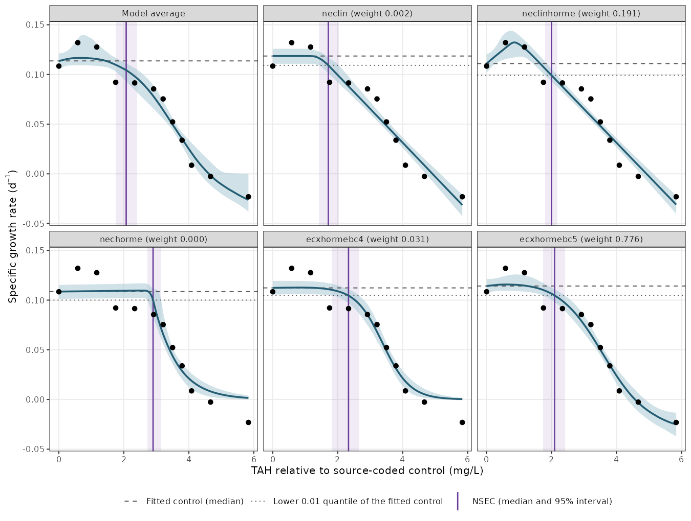
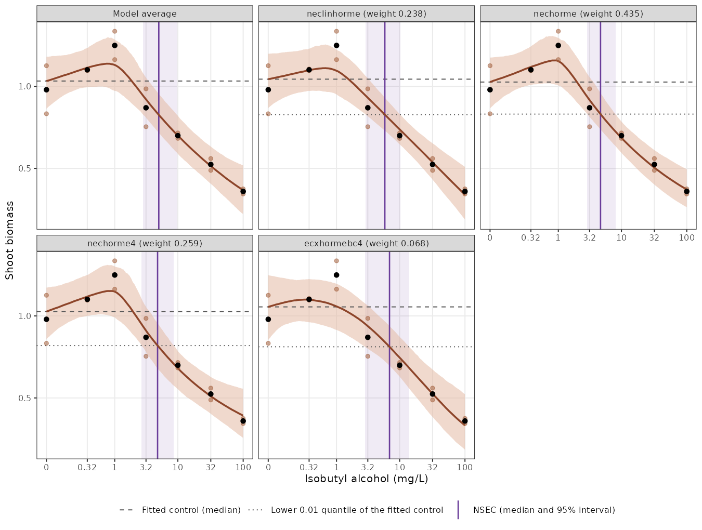

```{r}
#| label: setup
#| include: false
knitr::opts_chunk$set(dev = "png", dpi = 150, fig.align = "center")
```

# Abstract

Low concentrations of a toxicant can increase a measured biological response before higher concentrations reduce it, a pattern termed hormesis that is common in the algal and plant growth tests supplying many chronic inputs to water quality guideline values. Threshold equations that allow this pattern place their `nec` parameter at or just below the response maximum, so a value reported from that parameter as a no-effect concentration marks a stimulated response. We distinguish four locations on a hormetic curve (the peak, the return to the control, a control-based effect concentration (ECx) and a post-peak no-significant-effect concentration (NSEC)) and propose the last as an extension of the NSEC: the concentration on the declining limb at which the fitted mean falls below a lower quantile of the posterior distribution of the control response. Like a no-observed-effect concentration (NOEC), the NSEC has an associated effect size, which we report as the ECNSEC; unlike a NOEC, it is interpolated between the tested concentrations and has a credible interval. Most of the international guidance reviewed retains stimulated observations and measures inhibition against the true control, but none defines a regression-based no-effect estimate for a hormetic curve. We fitted candidate sets of threshold and smooth hormesis equations with `bayesnec` to growth rates of the marine dinoflagellate symbiont *Cladocopium goreaui* and to lettuce shoot biomass, and combined each set by model weights. For *C. goreaui*, growth rose 18–22% above the control at low concentrations, and the two equations with 0.967 of the weight gave post-peak NSECs of 2.00 and 2.09 mg/L total aromatic hydrocarbons, although only one reproduced the rise; the model-averaged NSEC was 2.07 mg/L (95% credible interval 1.74–2.42), with an ECNSEC of 8.6%. For lettuce, two imprecise controls gave a model-averaged NSEC of 5.07 mg/L with an ECNSEC of 20.0%, at the effect size above which the Australian and New Zealand method suggests an NSEC should probably not be used. A post-peak NSEC reported with its ECNSEC provides a no-effect estimate for a hormetic curve that is consistent with existing guidance on stimulation.

# Introduction

Water quality guideline values for toxicants are commonly derived by fitting a species sensitivity distribution to a chronic toxicity estimate for each tested species. The Australian and New Zealand method prefers negligible-effect estimates taken directly from the concentration–response relationship, in particular the no-effect concentration (NEC) and the no-significant-effect concentration (NSEC) [@warne2025]. An NEC is the breakpoint of a threshold model, below which the expected response does not differ from the control response [@Fox2010]. An NSEC is the highest concentration at which the predicted response does not differ significantly from the predicted response at zero concentration [@fisherfox2023]. In a Bayesian fit it is the concentration at which the fitted curve falls below a lower quantile (e.g. 1%) of the posterior distribution of the control response. The NSEC is conceptually linked to the no-observed-effect concentration (NOEC). However, because it is interpolated from a fitted curve, it does not depend directly on where the treatment concentrations were placed, and it can be given a statement of precision [@fisherfox2023; @fisher2023ieam].

Because the NSEC is defined by a significance test against the control, it has a non-zero effect associated with it, as a NOEC does [@fisher2023ieam]. We report that effect as the ECNSEC, the percentage decline of the fitted mean at the NSEC from the fitted control. The Australian and New Zealand method asks that the measured effect size of a NOEC or NSEC be considered before it is used, and suggests that values with an effect size above 20% should probably not be used to derive guideline values [@warne2025]. Where threshold and smooth equations are averaged, the NEC of the threshold equations and the NSEC of the smooth equations can be combined as a model-averaged N(S)EC [@fisher2023ieam]. Both the NEC and the NSEC were developed for a response that declines monotonically with concentration, and the glossary of the Australian and New Zealand method defines the NSEC using a *monotonically decreasing* model [@warne2025].

Not all concentration–response data decline monotonically. At low concentrations a measured response can rise above the control before falling at higher concentrations, a biphasic pattern termed hormesis [@calabrese2008; @canada2007alga; @usepa2012plants]. Environment Canada's algal test method uses the term only for a rise that is followed by inhibition, and calls an isolated rise stimulation [@canada2007alga], while its statistical guidance prefers the more general term low-dose stimulation, which also includes solvent effects and experimental error [@canada2005stats]. A review of the toxicological literature by @calabrese1998 judged about 350 of 4000 screened studies to show chemical hormesis, although @crump2001 argued that prevalence estimates of this kind did not adequately control for false positives. Stimulation is nonetheless frequent in the algal and aquatic plant tests that supply many chronic guideline inputs. For example, @cedergreen2007 found at least one treatment above 105% of the control in 25–76% of the growth-rate curves for each of *Lemna minor*, *Pseudokirchneriella subcapitata* and two terrestrial plants, and Environment Canada describes low-dose stimulation as perhaps the most common hindrance to the analysis of well-designed sublethal toxicity tests [@canada2005stats]. Literature reviews put the maximum stimulation at about 30–60% above the control [@calabrese2008], although Canadian laboratories regard about 30% as a more likely maximum [@canada2005stats].

The pattern is descriptive, and it does not by itself establish a beneficial effect or identify a mechanism. A growth factor introduced with the exposure can increase growth: Environment Canada notes that increased growth or cell production would be consistent with a nutrient added with the test material [@canada2005stats], and @negri2021condensate suggested that microalgae may use compounds from oil as a source of organic carbon. An organism may also allocate resources to the measured trait at the expense of reproduction or another trait [@forbes2000; @jager2013], and a stimulation of growth can be transient [@cedergreen2008]. @braincousens1989 cautioned, in addition, that apparent stimulation may often be an illusion where yields are standardised to a control mean that is implicitly treated as known without error. The measured endpoint, the true control and any other available endpoints should therefore be examined before the rising limb is interpreted as ecologically harmless. That biological judgement can, however, be made separately from the statistical treatment of the curve considered here.

Test guidelines and statistical guidance from several jurisdictions address stimulation, and most agree on two points. First, stimulated observations are retained and modelled. The revised OECD growth-inhibition test guideline (TG 201), which applies to freshwater algae and cyanobacteria, calls for fitting a standard monotone model and a suitable hormesis model, selecting between them using fit diagnostics and reporting the choice (paragraph 62); it also favours regression on individual replicate responses, uncertainty intervals for effect concentrations and reporting the observed stimulation [@oecd2026tg201]. Environment Canada's statistical guidance recommends fitting a hormesis model to all observations (Option 1 in section 10.3.3) and finds no statistical basis for omitting stimulated concentrations (Option 3) [@canada2005stats]. Similarly, Commission Regulation (EU) 2016/266 advises against deleting stimulated responses where possible [@eu2016alga], and US EPA plant-test guidance favours retaining individual replicates and analysing the influence of stimulation over discarding stimulated data [@usepa2012plants]. Second, inhibition is measured against the control. Environment Canada estimates the ICp of a hormesis model in relation to the *true control* and rejects smoothing the control upwards (Option 2), because that creates a reference response not observed in the test [@canada2005stats]. In its metals appendix, the European Chemicals Agency similarly advises that positive effects should not be considered in the derivation of an ECx [@echa2008metals].

These documents differ on when stimulation may be set aside. OECD TG 201 allows stimulation to be ignored only when it is less than 10% above the control and is not statistically significant in an appropriate post hoc test, and recommends a nonparametric method (e.g. linear interpolation with bootstrapping) where the monotone and hormesis models both fit poorly [@oecd2026tg201]. The EU regulation allows small stimulation to be ignored when estimating an EC50, but calls for a special procedure for low ECx values or extreme stimulation, for which it identifies interpolation with bootstrapping and, for extreme stimulation, a hormesis model [@eu2016alga]. Environment Canada's algal method substitutes control responses for stimulated concentrations (Option 4) only where regression is unsuitable and the ICPIN interpolation method is used, so this is a method-specific fallback and not a recommendation to alter the primary observations [@canada2007alga]. US EPA plant-test guidance defines an ICx as a reduction from the smoothed mean control response [@usepa2012plants]. In the ICp procedure that smoothing averages the control with adjacent treatment means until the means no longer increase, and US EPA's whole-effluent guidance notes that it may result in a large upward adjustment in the control mean where low concentrations are stimulated [@usepa2000wet], which is the procedure Environment Canada rejects. The European Chemicals Agency's advice is narrower in scope: it concerns hormesis observed with *essential nutrients* where an EC10 is extrapolated below the lowest tested concentration, for which it recommends a model other than the log-logistic [@echa2008metals].

For no-effect estimates, the guidance addresses hypothesis tests and not regression. Environment Canada treats low-dose stimulation as non-harmful in hypothesis testing (Option 5), so that only effects significantly worse than the true control are considered in designating the NOEC and LOEC [@canada2005stats]. OECD guidance on the statistical analysis of ecotoxicity data recommends pairwise comparison procedures for nonmonotone concentration–response data [@oecd2006stats]. US EPA whole-effluent guidance regards stimulation at low concentrations followed by a decline as a valid concentration–response relationship, for which hypothesis testing and point estimation provide reliable results, whereas an interrupted pattern can severely compromise the identification of a NOEC and LOEC and calls for checks of test conditions, randomisation, within-treatment variability and test sensitivity [@usepa2000wet]. Environment Canada also acknowledges that the calculation cannot decide whether stimulation is biologically adverse [@canada2005stats]. None of these documents defines a regression-based no-effect estimate for a hormetic curve. Across these jurisdictions, the control reference and the retention of observations therefore have stronger support than any particular no-effect definition for a hormetic curve.

Several equations have been proposed to describe a hormetic curve. Brain and Cousens modified the log-logistic model to allow a rising limb [@braincousens1989], and later reparameterisations estimate effect concentrations, the concentration of maximum stimulation and the concentration at which the response returns to the control directly, with their standard errors [@vanewijk1993; @schabenberger1999; @belzpiepho2012]. Cedergreen and colleagues proposed a more flexible empirical form, which detected significant hormesis in 18 of 51 macrophyte curves for which the Brain–Cousens model detected none [@cedergreen2005]. The choice of equation also changes these estimates: across 23 datasets, @belzpiepho2012 found differences of up to 1768% between the estimates from two equations where one was misspecified, compared with up to 26% where both fitted the data. In a Bayesian setting, @kim2015 averaged over monotone and hormetic models to estimate a benchmark dose, whereas the EFSA benchmark-dose guidance recommends Bayesian model averaging over monotone models only, and was not developed for ecotoxicological data [@efsa2022bmd]. `bayesnec` includes two smooth equations based on the Brain–Cousens form (`ecxhormebc4` and `ecxhormebc5`) and six threshold equations with a rising limb (`nechorme`, `nechorme4`, `neclinhorme`, `nechormepwr`, `nechorme4pwr` and `nechormepwr01`) [@fisher2024].

In a monotone threshold equation such as `nec3param`, the `nec` parameter locates the concentration at which a declining response starts, and the fitted response is at its control level up to that concentration. The threshold hormesis equations of `bayesnec` add a rising term below the threshold, and the `nec` parameter marks the concentration at which the declining term starts. In `neclinhorme` the rise and the decline are both linear, so a curve that declines beyond `nec` has its maximum there. In `nechorme` and `nechorme4` the rise can continue for a short distance beyond `nec` before the exponential decline overtakes it, so the parameter is at or below the peak. In each of these equations a positive fitted rise places the response at `nec` above the fitted control. If that value is passed to guideline derivation as a no-effect concentration, its name and its biological interpretation disagree. We encountered this in a mercury growth-rate series for a freshwater alga, in which several low concentrations exceeded the control before a decline; that series is privately shared and is not analysed here.

A hormetic curve has at least four locations that could be reported as a no-effect or low-effect concentration (@fig-estimands). The peak is the concentration of the maximum fitted response, termed M in the reparameterised Brain–Cousens and Cedergreen equations [@schabenberger1999; @belzpiepho2012]. The control return is the first concentration beyond the peak at which the fitted response falls back to the fitted control; Brain and Cousens called it the limiting dose for stimulation (LDS) [@braincousens1989], and Calabrese the zero equivalent point [@calabrese2008; @calabrese2019]. A control-based ECx is the concentration at which the response has fallen x% below the fitted control, measured from the control and not from the stimulated peak, as in the reparameterised hormesis equations [@vanewijk1993; @belzpiepho2012]. The post-peak NSEC, which we propose here, is the concentration on the declining limb at which the fitted response falls below a lower quantile of the posterior distribution of the control, and so extends the definition of @fisherfox2023 to a nonmonotone curve. Only the last two of these locate a decline below the control, and only the NSEC is defined by a statistical comparison with it, which makes it the regression counterpart of Environment Canada's rule for hypothesis tests. A threshold hormesis equation makes the peak an explicit parameter, whereas a smooth Brain–Cousens curve has no parameter named `nec`, so a comparison across equations, or an average over them, requires a common control-based estimand.

```{r}
#| label: fig-estimands
#| fig-width: 6
#| fig-height: 4
#| fig-cap: "A theoretical hormetic curve, $m(c)=1+0.25c\\exp(1-c)-0.15\\max(c-1,0)$, showing the four candidate locations, with each concentration given in the legend. The grey dashed lines mark the control response $m(0)=1$, a lower reference of 0.95 standing in for a lower posterior quantile of the control, and the EC10 target of 0.9. The peak is labelled with the `nec` parameter because, in a threshold hormesis equation, that parameter is where the decline starts: at the peak in `neclinhorme`, and at or just below it in `nechorme` and `nechorme4`. This applies only to the threshold hormesis equations; the smooth equations `ecxhormebc4` and `ecxhormebc5` have no `nec` parameter."
m <- function(z) 1 + 0.25 * z * exp(1 - z) - 0.15 * pmax(z - 1, 0)
x <- seq(0, 4, length.out = 400)
crossing <- function(target) uniroot(function(z) m(z) - target, c(1.01, 4))$root
locations <- c(Peak = 1, `Control return` = crossing(1),
               `Post-peak NSEC` = crossing(0.95), EC10 = crossing(0.9))
op <- par(mar = c(4.3, 4.4, 1, 0.5))
plot(x, m(x), type = "l", lwd = 2, xlab = "Relative concentration",
     ylab = "Mean response", ylim = c(0.55, 1.3))
abline(h = c(1, 0.95, 0.9), lty = 2, col = "grey60")
text(4, c(1, 0.95, 0.9), c("Control", "Lower reference", "EC10 target"),
     adj = c(1, -0.3), cex = 0.7, col = "grey40")
segments(locations, 0.55, locations, m(locations), lty = 1:4 + 1)
legend("topright", legend = sprintf("%s (%.2f%s)", names(locations), locations,
                                      c(" – nec", "", "", "")),
       lty = 1:4 + 1, bty = "n", cex = 0.8)
par(op)
```

Here we define these four locations formally and examine how well a design resolves them, using an exploratory simulation. We then fit candidate sets of monotone and hormetic equations to two publicly available datasets, and report the post-peak NSEC with its ECNSEC for each equation and for the model average. The first dataset is a series of individual growth rates of the marine dinoflagellate symbiont *Cladocopium goreaui*, released with @negri2021condensate, which @fisher2023ieam excluded from their comparison of no-effect estimators because of its hormetic shape. The second is the small `lettuce` dataset distributed with `drc` [@Ritz2016], which we use as a transparent comparison. These assays differ in organism, chemical, endpoint and replication, so they illustrate estimation questions without serving as interchangeable guideline inputs.

# Methods

## Candidate locations

Let $m(c)$ be the fitted mean at concentration $c$ of an endpoint for which a decrease represents poorer performance. We use the fitted mean at the unexposed treatment (the true control), $m(0)$, as the control response. A hormetic curve has an initial region with $m(c)>m(0)$ and a subsequent region in which the mean falls. The four locations shown in @fig-estimands are then defined as in @tbl-locations.

| Location | Definition | Interpretation |
| --- | --- | --- |
| Peak (M) | $c_{peak}=\arg\max m(c)$ | Maximum fitted response. The `nec` parameter of `neclinhorme` locates it, and that of `nechorme` or `nechorme4` is at or below it. |
| Control return (LDS, zero equivalent point) | First descending $c>c_{peak}$ with $m(c)=m(0)$ | The fitted response has returned to the unexposed mean. |
| Control-based ECx | First descending $c$ with $m(c)=m(0)(1-x/100)$ when zero is the effect target | A specified loss from the fitted control, not from the stimulated peak. |
| Post-peak NSEC | First descending $c$ at which $m(c)$ falls to a lower posterior quantile of $m(0)$ | Proposed extension of the NSEC to a nonmonotone response, reported with its ECNSEC. |

: Candidate locations on a hormetic curve for an endpoint in which a decrease represents poorer performance, with the names used in the hormesis literature in parentheses. {#tbl-locations}

For a positive peak and a control reference whose lower quantile is below $m(0)$, the peak precedes the control return, which in turn precedes the post-peak NSEC, provided all three crossings occur within the searched concentration range. This ordering follows from the definitions, and it does not imply that the unexposed mean is an ecological safety boundary. The NSEC also depends on the specified tail probability (`sig_val`) and on the precision of the experiment [@fisherfox2023]. For example, an imprecise control response places the lower reference further below $m(0)$, so that the crossing occurs at a higher concentration.

@fisherfox2023 defined the NSEC from a monotonically decreasing model as the highest concentration at which the predicted response does not differ significantly from the predicted response at zero concentration. Applied to a hormetic curve, that wording already selects a concentration on the declining limb, because a significant rise is also a significant difference from the control. The post-peak NSEC makes the comparison one-sided, so that only a decline counts as an effect, which matches Environment Canada's treatment of low-dose stimulation as non-harmful in hypothesis tests [@canada2005stats].

The ECNSEC is calculated draw by draw. Let $m_s(c)$ be the fitted mean of posterior draw $s$ and $r$ the `sig_val` quantile of the posterior distribution of $m(0)$. The NSEC of draw $s$ is the first descending concentration at which $m_s(c)=r$, and its ECNSEC is $100\,(m_s(0)-r)/m_s(0)$, the decline from that draw's control to the reference, measured towards zero as for an absolute ECx. The reference $r$ is a single value for the fit, so the ECNSEC depends on the posterior of the fitted control and not on the declining limb. It describes the smallest decline from the control that the experiment distinguishes at the chosen `sig_val`, which is the sense in which a NOEC also has an effect size [@fisher2023ieam]. The NSEC is then the concentration at which the fitted curve has declined by that amount.

In `bayesnec`, `ecx()` measures an effect from the fitted control for each equation in a model set. `nsec()` likewise takes the `sig_val` quantile of the posterior of the control as its reference and returns the first decreasing crossing of that reference, with the paired ECNSEC in its `ecnsec_relativeP` attribute. For a threshold hormesis equation, `nec()` returns this NSEC as the no-effect estimate, and `curve_params()` returns the sampled `nec` parameter, which describes the peak. For a model set, the averaged NSEC is a mixture of the posterior NSEC draws of each equation in proportion to its model weight, with the ECNSEC of each draw taken from that draw, and `nec()` on a set that mixes monotone threshold equations with other equations returns the model-averaged N(S)EC [@fisher2023ieam]. The crossing is post-peak for posterior draws with a fitted rise, whereas a draw without stimulation may cross the reference without an intervening peak. The equation or model set and the location reported should therefore both be identified in a guideline data table.

## Exploratory simulation

We generated a continuous response with a known peak and a declining limb,

$$m(c)=1+a(c/p)\exp(1-c/p)-b\max(c-p,0),$$

where the peak location $p=1$, the decline coefficient $b=0.15$, and the stimulation amplitude $a$ was either 0.10 or 0.25. Gaussian observation error had a standard deviation of 0.08. We varied the number of positive concentrations (five or nine) and the number of replicates per concentration (three or ten), and generated 250 independent datasets for each of the eight designs. The positive concentrations were logarithmically spaced from 0.1 to 4, and each design also contained an unexposed control.

We fitted the generating equation to each dataset by bounded least squares and calculated its peak, its descending return to the fitted control and its control-based EC10. We also located a lower-reference crossing at the fitted control minus 2.326 standard errors (an approximate one-sided 1% Gaussian reference). This last calculation is a plug-in proxy for the NSEC, not `bayesnec`'s posterior NSEC. The simulation therefore checks the separation of the locations and whether a design resolves them; for example, a design whose highest treatment remains above the control cannot identify a descending control return. It cannot establish posterior coverage, model selection performance or guideline protection. The script is `analysis/hormesis_simulation.R`.

## Case-study observations

The [public workbook](https://data.aims.gov.au/data-download/615e208d-f6c7-4b2f-b99e-d4fc50614e48/Negri_etal_2021_Experimental-data_Toxicity-thresholds-gas-condensate-oils.xlsx) accompanying @negri2021condensate contains 65 individual specific growth rates of *C. goreaui* (ten no-WAF controls and five replicates at each of 11 exposure concentrations) [@aims2020condensatedata]. The workbook codes the total aromatic hydrocarbon (TAH) concentration of the controls as 1 $\mu$g/L. We retained that source value and subtracted 1 $\mu$g/L from all concentrations to set the no-WAF treatment at zero, then divided by 1000 to report estimates in mg/L TAH relative to this source-coded control. This shift is an analysis convention, because the workbook does not by itself establish that 1 $\mu$g/L was a measured background. The data record labels the workbook [CC BY-NC 3.0 Australia](https://researchdata.edu.au/condensate-toxicity-testing/1702929), so the individual observations are imported locally by `analysis/hormesis_negri.R` and are not redistributed with this compendium.

The `drc::lettuce` dataset contains shoot biomass after 21 days of exposure to isobutyl alcohol in a nutrient solution, with two observations at each of seven concentrations from zero to 100 mg/L (@fig-lettuce-data). We copied those 14 observations from the current CRAN source of `drc` (GPL-2). Under the installed `drc` licence text its datasets are not copyright, and no separate restriction appeared with `lettuce.rda`. We cite the original dataset context and `drc` [@vanewijk1993; @Ritz2016]. The small sample and terrestrial endpoint make this a methods example and not an aquatic guideline-value input.

```{r}
#| label: fig-lettuce-data
#| fig-width: 6
#| fig-height: 4
#| fig-cap: "The 14 individual lettuce shoot biomass observations. The concentration axis is log10(concentration + 0.1), labelled in mg/L, and the line joins treatment means for visual orientation; it is not a fitted model."
lettuce <- read.csv("data/hormesis_lettuce_1993.csv")
op <- par(mar = c(4.3, 4.4, 1, 0.5))
plot(lettuce$weight ~ log10(lettuce$conc + 0.1), pch = 16,
     col = "#A25D3A88", xaxt = "n", xlab = "Isobutyl alcohol (mg/L)",
     ylab = "Shoot biomass")
axis(1, at = log10(sort(unique(lettuce$conc)) + 0.1),
     labels = sort(unique(lettuce$conc)), cex.axis = 0.75)
with(aggregate(weight ~ conc, lettuce, mean),
     lines(log10(conc + 0.1), weight, lwd = 2))
par(op)
```

## Model fitting and comparison

We fitted a Gaussian response family with an identity link to both datasets, which permits negative fitted values where the measured endpoint can be negative, as it is for the *C. goreaui* growth rates. Five hormesis equations were candidates for each dataset: the linear-limb threshold `neclinhorme`, the exponential threshold forms `nechorme` and `nechorme4`, and the four- and five-parameter smooth Brain–Cousens forms `ecxhormebc4` and `ecxhormebc5`. The marine set also included the monotone threshold equation `neclin` as a comparator, and used recorded concentration as the predictor. For lettuce, all five equations used `log(concentration + 0.1)` as the predictor because exposure spans more than two orders of magnitude; the offset retains the control, and estimates are reported in mg/L. The candidate equations differ in how their declining limbs end. `nechorme` and `ecxhormebc4` decline towards zero, `nechorme4` and `ecxhormebc5` estimate a lower asymptote that can be negative, and `neclin` and `neclinhorme` decline linearly without a lower bound. The unscaled power threshold forms (`nechormepwr` and `nechorme4pwr`) add one response unit at a marine concentration of 1 mg/L before decline, much larger than the observed rise, and their fractional powers are undefined at the negative transformed lettuce control value. The bounded form `nechormepwr01` cannot represent lettuce biomass above one or negative marine growth. We therefore did not fit these three forms.

Each equation was fitted with four chains of 2000 iterations, including 1000 warm-up iterations, with seed 570, `adapt_delta` of 0.995 (marine) or 0.99 (lettuce) and a maximum tree depth of 12; the five-parameter Brain–Cousens fits used zero initial values. An equation that failed a sampler screen (any parameter with a rank-normalised $\widehat{R}$ above 1.01 or an effective sample size below 400, or any divergent transition) was refitted for longer under the same prior (6000 iterations, 4000 of them warm-up, thinned by two, with a higher `adapt_delta`), and was excluded from its set only if the refit also failed, which excluded one equation from each set [@Vehtari2021]. The retained equations of each set were weighted by pseudo-BMA weights computed from their Pareto-smoothed importance sampling leave-one-out (PSIS-LOO) predictive densities [@vehtari2017; @Yao2018], with the lettuce scores for influential observations computed by exact refitting. The model-averaged curve and estimates are mixtures of the posterior draws of the retained equations in proportion to these model weights [@fisher2024].

For each retained equation we calculated the NSEC with `sig_val = 0.01` and its paired ECNSEC, the control-based EC10, the peak of the posterior median curve and, for the threshold equations, the sampled `nec` parameter. The model-averaged NSEC and ECNSEC were taken from `nsec()` on each set, so that the model average and the individual equations are reported on the same draw-wise basis; `nec()` on the marine set, which includes `neclin`, returns the model-averaged N(S)EC instead. The fitting, screening and weighting are in `analysis/hormesis_case_fits.R`, and the figures and estimates are recreated from the saved fits by `analysis/hormesis_fit_plots.R`.

# Results

## Simulation study

```{r}
#| label: tbl-simulation
#| tbl-cap: "Median (2.5–97.5% range) of the fitted locations across 250 simulated datasets per design. Concentrations include the control. The ranges are simulation quantiles, not credible intervals. The true peak is 1; the true control return is 1.59 (amplitude 0.10) or 2.14 (0.25), and the true EC10 is 2.13 or 2.56. Between 98.8% and 100% of fits converged in each design."
sim <- read.csv("data/hormesis_simulation_summary.csv")
sim$cell <- sprintf("%.2f (%.2f–%.2f)", sim$median, sim$q025, sim$q975)
wide <- reshape(sim[, c("amplitude", "levels", "replicates", "metric", "cell")],
                idvar = c("amplitude", "levels", "replicates"),
                timevar = "metric", direction = "wide")
wide <- wide[order(wide$amplitude, wide$levels, wide$replicates), ]
knitr::kable(
  wide[, c("amplitude", "levels", "replicates", "cell.peak", "cell.return",
           "cell.lower_crossing", "cell.ec10")],
  row.names = FALSE,
  col.names = c("Amplitude", "Concentrations", "Replicates", "Peak",
                "Control return", "Lower-reference crossing", "EC10")
)
```

```{r}
#| label: fig-simulation
#| fig-width: 9
#| fig-height: 5.5
#| fig-cap: "Generating curves (dashed black) and median fitted curves (blue) across 250 simulated datasets per design. Shading gives the 2.5–97.5% range of the fitted mean at each concentration across datasets, excluding observation error. Each panel names the stimulation amplitude, total number of concentrations including the control, and replicates per concentration."
sim_curves <- read.csv("data/hormesis_simulation_fitted_curves.csv")
sim_curves$design <- factor(
  sprintf("%d concentrations, %d replicates",
          sim_curves$levels, sim_curves$replicates),
  levels = c("6 concentrations, 3 replicates",
             "6 concentrations, 10 replicates",
             "10 concentrations, 3 replicates",
             "10 concentrations, 10 replicates")
)
sim_curves$amplitude <- factor(sim_curves$amplitude,
                               levels = c(0.1, 0.25),
                               labels = c("Amplitude 0.10", "Amplitude 0.25"))
ggplot2::ggplot(sim_curves, ggplot2::aes(x = conc)) +
  ggplot2::geom_ribbon(ggplot2::aes(ymin = fitted_q025, ymax = fitted_q975),
                       fill = "#A9CAD5", alpha = 0.65) +
  ggplot2::geom_line(ggplot2::aes(y = fitted_median),
                     colour = "#245D73", linewidth = 0.6) +
  ggplot2::geom_line(ggplot2::aes(y = true_mean), linetype = "dashed",
                     linewidth = 0.5) +
  ggplot2::facet_grid(amplitude ~ design) +
  ggplot2::labs(x = "Relative concentration", y = "Mean response") +
  ggplot2::theme_bw(base_size = 9) +
  ggplot2::theme(strip.text.x = ggplot2::element_text(size = 8))
```

Across the eight designs, the median fitted peak was within 0.02 of its true value, and the median control return and EC10 were within 0.07 of theirs (@tbl-simulation). Their spread depended mainly on the stimulation amplitude and on replication. With weak stimulation, three replicates and six concentrations, the 2.5–97.5% range of the peak extended from 0.57 to the upper bound of the fit (3), and that of the control return from 0.82 to 3.02. With strong stimulation, ten replicates and ten concentrations, the corresponding ranges were 0.86–1.15 and 2.00–2.30, and the median return of 2.14 matched the true return of the generating curve. Increasing the number of concentrations from six to ten narrowed these ranges with weak stimulation and three replicates, but changed the medians by less than 0.04.

Across the 250 fits in each design, the median fitted mean followed the generating curve (@fig-simulation). The between-dataset range was wider with three replicates, particularly when the stimulation amplitude was 0.10, and ten replicates narrowed it around the peak and on the declining limb. These bands describe uncertainty across simulated experiments, not a posterior predictive interval for one observation.

The lower-reference crossing depended on replication as well as on the curve. With weak stimulation and six concentrations, its median was 2.06 with three replicates and 1.85 with ten; with strong stimulation the corresponding medians were 2.51 and 2.32. With three replicates the median crossing was 0.32–0.44 beyond the median control return and 0.05–0.10 below the median EC10, whereas with ten replicates it was 0.19–0.25 beyond the return and 0.23–0.29 below the EC10. These contrasts show the ordering implied by the definitions, and why a peak cannot be substituted for a control-based no-effect location. They also suggest, at least for this generating curve, that the precision of the control response largely determines how far beyond the control return the NSEC falls. They do not measure how well the Bayesian NSEC performs, because the proxy uses a Gaussian plug-in uncertainty calculation.

## *Cladocopium goreaui* growth rates

The ten *C. goreaui* controls had a mean specific growth rate of 0.108 d^-1^ (standard deviation 0.0075 d^-1^). The treatment means at 0.583 and 1.17 mg/L TAH were 22% and 18% above the control mean, and the means at 1.75, 2.33 and 2.92 mg/L were 85%, 84% and 79% of it (@fig-marine). Growth then declined steeply, to 48% of the control at 3.50 mg/L and 8% at 4.08 mg/L, and the mean growth rates at 4.67 and 5.84 mg/L were negative. The series therefore shows hormesis in Environment Canada's sense [@canada2007alga], a rise at the two lowest concentrations followed by inhibition, with a plateau about 15% below the control across the next three treatments. The 22% rise exceeds the 10% size condition in OECD TG 201, although that test guideline applies to freshwater algae and also requires a statistical test before stimulation can be ignored [@oecd2026tg201].

The screen excluded `nechorme4`, and @fig-marine shows the remaining five equations with their model weights (@tbl-marine). Most of the weight went to `ecxhormebc5` (0.776) and `neclinhorme` (0.191), which appears to follow from the shapes of their declining limbs: the lower asymptote of `ecxhormebc5` follows the negative growth rates at 4.67 and 5.84 mg/L, whereas `nechorme` (weight below 0.001) and `ecxhormebc4` (0.031) level off at zero, and the monotone `neclin` (0.002) has no rise.

`neclinhorme` reproduces the hormesis in these data. Its fitted mean at the 0.583 and 1.17 mg/L treatments was 114% of its fitted control, and its posterior median curve peaked at 0.914 mg/L, with a draw-wise maximum rise of 22% (95% credible interval 1.5–39%) above the control. Its sampled `nec` parameter, 0.918 mg/L (0.559–1.46), is that peak: a concentration at which its fitted mean is well above its fitted control, and which `nec()` therefore does not return as its no-effect estimate. The other hormesis equations showed little rise (median 0.21% for `ecxhormebc5`, 0.056% for `ecxhormebc4` and 0.43% for `nechorme`), so the `nec` parameter of `nechorme` (2.83 mg/L) marks the start of what is in effect a monotone decline, and the model-averaged curve, which `ecxhormebc5` dominates, rose only slightly.

Under the post-peak NSEC, the two equations with 0.967 of the model weight nonetheless gave similar no-effect estimates: 2.00 mg/L (1.80–2.18) for `neclinhorme` and 2.09 mg/L (1.73–2.41) for `ecxhormebc5` (@tbl-marine). Each NSEC is read on the declining limb against the equation's own control, so it depends on where the curve falls below its lower reference and not on whether the curve first rises, which may explain why the two estimates are close. The model-averaged NSEC was 2.07 mg/L (1.74–2.42), between the 1.75 and 2.33 mg/L treatments, with an ECNSEC of 8.62% (1.46–15.2%). In each equation's panel the ECNSEC is the gap between the dashed and dotted lines (for example, 0.111 and 0.0991 d^-1^ for `neclinhorme`, an ECNSEC of 10.6%), and because ten controls estimate the control precisely the gap is small: the model-averaged NSEC is just below the model-averaged EC10 of 2.16 mg/L (1.71–2.58). Across the equations, the NSEC ranged from 1.71 mg/L for `neclin` to 2.90 mg/L for `nechorme`, and the ECNSEC from 6.94% to 10.6%. `nec()` on the set returns the N(S)EC of 2.07 mg/L (1.74–2.42), equal to the NSEC to three figures because `neclin` has 0.002 of the weight.

```{r}
#| label: fig-marine
#| out-width: "100%"
#| fig-cap: "Model-averaged (first panel) and candidate fits to individual *C. goreaui* growth rates, with each equation's model weight in its panel title. Each panel shows the posterior median fitted mean (line) and its 95% credible band (shading), the median fitted control (dashed line), the lower 0.01 quantile of the posterior of the fitted control (dotted line), and the NSEC as a purple line (median) with purple shading (95% credible interval). The model-average panel has no dotted line, because its NSEC mixes the equations' posterior draws, each read against its own control. Black points are treatment means calculated from the Negri et al. (2021) workbook (CC BY-NC 3.0 Australia); individual observations are not redistributed. TAH concentrations are relative to the source-coded control."

```

| Equation | Model weight | Fitted control (d^-1^) | Lower 1% reference (d^-1^) | `nec` parameter, mg/L | Rise at peak, % | NSEC, mg/L | ECNSEC, % | EC10, mg/L |
| --- | --- | --- | --- | --- | --- | --- | --- | --- |
| Model average | 1 | 0.114 | 0.102 | — | 0.78 (0–33) | 2.07 (1.74–2.42) | 8.62 (1.46–15.2) | 2.16 (1.71–2.58) |
| `neclin` | 0.002 | 0.119 | 0.109 | 1.43 (1.10–1.94) (NEC) | 0 | 1.71 (1.42–2.04) | 7.90 (1.42–13.2) | 1.77 (1.49–2.23) |
| `neclinhorme` | 0.191 | 0.111 | 0.0991 | 0.918 (0.559–1.46) | 22 (1.5–39) | 2.00 (1.80–2.18) | 10.6 (2.25–17.8) | 1.98 (1.65–2.28) |
| `nechorme` | <0.001 | 0.109 | 0.100 | 2.83 (2.64–3.12) | 0.43 (0.001–5.7) | 2.90 (2.73–3.15) | 7.92 (1.20–13.3) | 2.91 (2.75–3.17) |
| `ecxhormebc4` | 0.031 | 0.112 | 0.104 | — | 0.056 (0–3.7) | 2.33 (1.82–2.66) | 6.94 (0.929–12.4) | 2.50 (2.08–2.85) |
| `ecxhormebc5` | 0.776 | 0.114 | 0.105 | — | 0.21 (0–15) | 2.09 (1.73–2.41) | 8.37 (1.58–13.7) | 2.19 (1.74–2.57) |

: Pseudo-BMA model weights and estimates for the *C. goreaui* candidate set, as posterior medians with 95% credible intervals. The fitted control is the posterior median of the mean at zero concentration, against an observed control mean of 0.108 d^-1^, and the lower 1% reference is the 0.01 quantile of its posterior. The rise at peak is the maximum of each draw's curve above that draw's fitted control. The ECNSEC is the decline from the fitted control at the NSEC, calculated draw by draw. For monotone `neclin` the `nec` parameter is its NEC. TAH concentrations are relative to the source-coded control. {#tbl-marine}

@negri2021condensate reported an NEC of 3.1 mg/L TAH (95% credible interval 2.9–3.4) and an EC10 of 2.67 mg/L (2.31–2.95) for these data from fits with `jagsNEC`, and used the EC10 as the *C. goreaui* input to their species sensitivity distribution.

## Lettuce biomass

The lettuce control observations were 0.833 and 1.126 (a mean of 0.98), and differed from each other by more than the rise from the control mean to the mean of 1.25 at 1 mg/L (0.29 against 0.27), which was 28% above the control mean (@fig-lettuce-data). The mean at 0.32 mg/L was 12% above the control mean. Biomass then declined, to 89% of the control mean at 3.2 mg/L, 71% at 10 mg/L and 37% at 100 mg/L. The control response therefore appears imprecise relative to the rise. The lettuce assay falls outside the scope of OECD TG 201, and its rise and the marine rise may reflect different processes, which these observations cannot identify.

The screen excluded `ecxhormebc5`, and @fig-lettuce shows the remaining four equations with their model weights (@tbl-lettuce). The three threshold hormesis equations had 0.932 of the weight (`nechorme` 0.435, `nechorme4` 0.259 and `neclinhorme` 0.238), and each of their curves rises above its fitted control to a peak near 1 mg/L, whereas `ecxhormebc4` (0.068) rises less (median 2.5%). Their sampled `nec` parameters were 0.919 mg/L (0.201–2.46) for `neclinhorme`, 1.10 mg/L (0.484–2.87) for `nechorme` and 1.12 mg/L (0.337–3.42) for `nechorme4`, with median draw-wise rises of 5.3%, 15% and 14% above the fitted control. The model-averaged curve peaked at 1.02 mg/L, 11% (0.0004–46%) above its fitted control.

```{r}
#| label: fig-lettuce
#| out-width: "100%"
#| fig-cap: "Model-averaged (first panel) and candidate fits to lettuce shoot biomass, with each equation's model weight in its panel title. Each panel shows the posterior median fitted mean (line) and its 95% credible band (shading), the median fitted control (dashed line), the lower 0.01 quantile of the posterior of the fitted control (dotted line), and the NSEC as a purple line (median) with purple shading (95% credible interval). The model-average panel has no dotted line, because its NSEC mixes the equations' posterior draws, each read against its own control. Pale points are individual observations and black points are treatment means. Concentrations are labelled in mg/L on the axis of @fig-lettuce-data."

```

| Equation | Model weight | Fitted control | Lower 1% reference | `nec` parameter, mg/L | Rise at peak, % | NSEC, mg/L | ECNSEC, % | EC10, mg/L |
| --- | --- | --- | --- | --- | --- | --- | --- | --- |
| Model average | 1 | 1.03 | 0.822 | — | 11 (0.0004–46) | 5.07 (2.90–9.90) | 20.0 (4.19–30.2) | 3.14 (1.02–8.25) |
| `neclinhorme` | 0.238 | 1.04 | 0.828 | 0.919 (0.201–2.46) | 5.3 (0.003–38) | 5.90 (2.98–10.2) | 20.7 (4.66–31.0) | 3.01 (0.804–8.88) |
| `nechorme` | 0.435 | 1.03 | 0.831 | 1.10 (0.484–2.87) | 15 (0.006–47) | 4.74 (2.95–8.11) | 19.0 (4.09–29.3) | 3.17 (1.34–7.71) |
| `nechorme4` | 0.259 | 1.03 | 0.819 | 1.12 (0.337–3.42) | 14 (0.009–49) | 4.85 (2.73–8.66) | 20.2 (4.40–30.1) | 3.05 (1.31–7.74) |
| `ecxhormebc4` | 0.068 | 1.06 | 0.812 | — | 2.5 (0–33) | 6.97 (2.89–13.9) | 23.0 (4.89–35.0) | 2.94 (0.344–10.4) |

: Pseudo-BMA model weights and estimates for the lettuce candidate set, as posterior medians with 95% credible intervals. The fitted control is the posterior median of the mean at zero concentration, against an observed control mean of 0.98, and the lower 1% reference is the 0.01 quantile of its posterior. The rise at peak is the maximum of each draw's curve above that draw's fitted control. The ECNSEC is the decline from the fitted control at the NSEC, calculated draw by draw. {#tbl-lettuce}

The ECNSEC of each lettuce fit is set by its control, because each draw's ECNSEC is its decline from the fitted control to the fixed lower 1% reference (see Methods), so in @fig-lettuce it is the gap between the dashed and dotted lines, expressed as a percentage of the dashed line. The lettuce control observations differ by 0.29, more than the observed rise to 1 mg/L, and with only two observations the posterior of the fitted control is wide. Its lower 1% quantile is therefore about 20% below the fitted control (0.822 against 1.03 for the model average), and the model-averaged ECNSEC was 20.0% (4.19–30.2%), against 8.62% for the ten *C. goreaui* controls (@tbl-marine). The model-averaged NSEC of 5.07 mg/L (2.90–9.90) is the concentration at which the averaged curve has declined by that amount, between the 3.2 and 10 mg/L treatments. Because the ECNSEC is above 10%, the NSEC is beyond the model-averaged EC10 of 3.14 mg/L (1.02–8.25), whereas for *C. goreaui*, with an ECNSEC of 8.62%, the NSEC of 2.07 mg/L is just below the EC10 of 2.16 mg/L. The ECNSECs of the individual lettuce equations ranged from 19.0% to 23.0% (@tbl-lettuce). The Australian and New Zealand method screens NOECs and NSECs on this effect size, and states that any with an effect size above 20% should probably not be used to derive guideline values [@warne2025]. The lettuce NSEC is at that limit, with a median ECNSEC of 20.0% and an upper credible bound of 30.2%, and may therefore not be suitable as a guideline input under that screen. A larger control group would likely narrow the posterior of the fitted control, and so lower both the ECNSEC and the NSEC [@fisherfox2023].

# Discussion

For a hormetic growth response, the Canadian statistical guidance and the OECD freshwater algal test guideline support retaining stimulated observations in an appropriate model and assessing subsequent inhibition relative to the unexposed control [@canada2005stats; @oecd2026tg201]. These documents do not define an NSEC for a nonmonotone curve. The peak is a useful description of the shape of the curve, especially where a threshold equation makes it an explicit parameter, but a positive fitted rise places the response there above the control, so it cannot represent a concentration at which the endpoint is unchanged. The post-peak NSEC is read from the declining limb against the control, and it keeps the properties that @fisherfox2023 gave the NSEC of a monotone curve: it is interpolated between the tested concentrations, it has a credible interval, and like the NOEC it is defined by a significance level. In the case studies, the model-averaged NSEC was 2.07 mg/L for *C. goreaui*, between the 1.75 and 2.33 mg/L treatments, and 5.07 mg/L for lettuce, between 3.2 and 10 mg/L (@tbl-marine; @tbl-lettuce). Because the NSEC is read against the control on the declining limb, it was also similar for the two marine equations with most of the model weight, only one of which reproduced the rise, whereas a peak exists only in an equation that represents the rise. This suggests, at least for these data, that the post-peak NSEC is less sensitive than the peak to which candidate equations a set contains. A NOEC from these designs could take only one of the tested concentrations.

Because the NSEC is defined by a significance test against the control, it is a statistical no-effect estimate with an associated effect size, as a NOEC is [@fisher2023ieam], and its ECNSEC should be reported beside it. The Australian and New Zealand method already asks for the effect size of a NOEC or NSEC to be considered, and suggests that values with an effect above 20% should probably not be used [@warne2025]. The ECNSEC is calculated from the posterior of the fitted control, since each draw is compared with one lower reference, so it measures how precisely the experiment estimated the control. The lettuce NSEC, whose ECNSEC is at that limit, is the case in which the screen applies. This is the dependence on replication that @fisherfox2023 described for the NSEC of a monotone curve, where poor experiments favour larger NSECs, and the simulation here suggests a similar dependence for a hormetic curve: the median lower-reference crossing was 0.32–0.44 beyond the median control return with three replicates and 0.19–0.25 beyond it with ten. Where the ECNSEC is large, @fisher2023ieam suggested comparing the NSEC with a relevant ECx and adopting the lower value, as @negri2021condensate did with the NEC and EC10.

The *C. goreaui* fits suggest that the choice of equation changes the reference as well as the curve. A monotone equation fitted to a stimulated series raises its fitted control towards the stimulated means, which is in effect the upward smoothing of the control that Environment Canada rejects. Environment Canada notes that applying common techniques to stimulated data often overestimates the control performance and lowers the endpoint [@canada2005stats]. The `neclin` fit followed that pattern here: its fitted control was 0.119 d^-1^, 10% above the observed control mean of 0.108 d^-1^, because its flat upper limb averages the control with the stimulated treatments, and its NEC (1.43 mg/L), NSEC (1.71 mg/L) and EC10 (1.77 mg/L) were the lowest of the set (@tbl-marine). The data gave it a model weight of 0.002, which suggests that a monotone curve is poorly supported for this series. Excluding hormesis equations from a candidate set therefore does not avoid the problem of stimulation, and it may make the reference less faithful to the observed control. The shape of the declining limb near the control level also determines where the NSEC falls, so agreement in EC10 does not establish agreement in NSEC where the descending limbs differ near the control response. This sensitivity to curve shape is consistent with the large differences between misspecified and well-fitting hormesis equations reported by @belzpiepho2012. Model averaging accommodates it by weighting the candidate equations by their predictive support, so that the averaged NSEC reflects the shapes the data support and not a single equation chosen in advance [@fisher2023ieam].

The preference for a control-based NSEC does not resolve the ecological meaning of stimulation. If increased growth draws resources from reproduction, a growth-based NSEC could miss an adverse effect below the peak [@forbes2000; @jager2013]. If the stimulus comes from nutrients or an organic carbon source in a mixture, the curve may describe a mixture effect whose relevance changes with receiving-water chemistry. @kefford2008 argued that incorporating stimulation into ecotoxicology requires assumptions and value judgements, could lower water quality standards, and is not clearly necessary except perhaps in fitting concentration–response curves, and @chapman2002 placed its consideration in detailed, not screening-level, ecological risk assessment. The post-peak NSEC is a proposal of the limited kind Kefford and colleagues allow: it changes where a fitted curve is read, and it does not treat stimulation as a benefit. A chemical-specific guideline must therefore examine exposure measurement, endpoint relevance, other traits and the evidence for the mechanism. For metals, the European Chemicals Agency's advice to use measured concentrations and to document how medium chemistry and background affect bioavailability is relevant to this examination, although its essential-nutrient advice cannot be assumed to apply to a non-essential metal such as mercury [@echa2008metals]. An estimate censored above the tested concentrations or dependent on a poorly fitting declining limb should be reported as unresolved, even if a point value can be calculated; US EPA plant-test guidance similarly assigns lower confidence to endpoints extrapolated beyond the tested concentrations [@usepa2012plants].

The Australian and New Zealand NSEC definition refers to a monotonically decreasing model [@warne2025], and its use for a hormetic curve would require that definition to admit a nonmonotone model and to count only a decline from the control as an effect. A full Bayesian simulation would support that change, by evaluating the bias, posterior coverage and ECNSEC of the post-peak NSEC under censoring, model misspecification, weak stimulation, concentration placement and replicate allocation. Design should be part of that evaluation. @calabrese1998 associated high to moderate evidence for hormesis with studies of more than six doses, more than three of them in the hormetic zone, and the estimated maximum stimulation increases with the number of doses below the zero equivalent point [@calabrese2019]. Optimal designs for detecting hormesis and for estimating the threshold dose and the zero equivalent point have been derived [@dette2011; @casero2018], and a simulation of the post-peak NSEC should compare such designs with those of standard test guidelines. The exploratory simulation here isolates the geometric and design question, the marine case supplies an analysis previously deferred because of its hormetic shape, and lettuce shows how an imprecise control enlarges the ECNSEC. Together they provide a reproducible basis for that validation, and a clear distinction between a curve parameter and the guideline estimand.

# Reproducibility

The *C. goreaui* fits were run outside this document, because the individual observations are not redistributed. `analysis/hormesis_negri.R` downloads the workbook and writes the observations to `ignore/`, which is excluded from the repository. `analysis/hormesis_case_fits.R` fits both candidate sets, screens and refits them, computes the model weights and saves the fitted objects, and `analysis/hormesis_fit_plots.R` recreates @fig-marine, @fig-lettuce and the estimates in @tbl-marine and @tbl-lettuce from those saved objects. Each fit used `seed = 570`, and the weights were computed after `set.seed(570)`.
The fits used `bayesnec` at commit `9b99f600` with R 4.6.1, `brms` 2.23.0 and `rstan` 2.32.7.
The simulation summary in @tbl-simulation and the fitted curves in @fig-simulation are stored in `data/hormesis_simulation_summary.csv` and `data/hormesis_simulation_fitted_curves.csv`, generated together by `analysis/hormesis_simulation.R` with seed 570. The lettuce observations in @fig-lettuce-data are read from `data/hormesis_lettuce_1993.csv`.

# References
